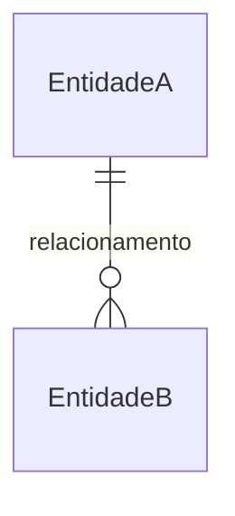

# Documentação técnica

> **Pasta da skill.** Os caminhos abaixo partem da pasta da skill, nunca do diretório atual. Na configuração global do
> OpenCode, ela fica em `${XDG_CONFIG_HOME:-$HOME/.config}/opencode/skills/technical-documentation-generator`. Se o
> `opencode/` for sincronizado em outro destino, ajuste esse caminho para `<destino>/skills/technical-documentation-generator`.
> **A skill é somente leitura.** Ela é global e compartilhada entre projetos. Nunca grave artefato nela: os dados
> deste projeto vão para `<projeto>/.agents/technical-documentation-generator/` e o que se baixa uma vez por máquina
> vai para `~/.cache/skill-kit`.

Funciona para qualquer tipo de projeto: APIs REST/GraphQL, frontends (React, Vue, Svelte, Angular), apps mobile
(React Native, Flutter, Swift, Kotlin), desktop (Electron, Tauri), CLIs, bibliotecas, monorepos.

**Toda documentação gerada deve estar em português brasileiro**, salvo se o usuário pedir outro idioma.

## Dois perfis — escolha antes de começar

| Perfil | Quando | Fonte | Saída |
|---|---|---|---|
| **A — Catálogo por tema** | o pedido nomeia o artefato: "ADR", "tabela de endpoints", "documenta os models", "rotas", "variáveis de config" | código-fonte | um arquivo por tema em `docs/` |
| **B — Consolidado de módulo** | o pedido é o módulo inteiro: "documenta o módulo X", "README técnico", "consolida o Swagger" | código + **contrato OpenAPI ao vivo** | um README principal + anexo de DTOs |

Os dois podem ser usados na mesma sessão, mas **não no mesmo arquivo**: o perfil A mantém o catálogo temático em
`docs/`; o perfil B escreve um documento único do módulo no caminho que o usuário escolher.

## Princípios (valem nos dois perfis)

- Documente o que **existe no código**, nunca suposições.
- Antes de escrever qualquer coisa, **leia** os arquivos de código relevantes.
- Ao atualizar um arquivo existente, preserve as seções que não está alterando.
- Inclua diagramas Mermaid sempre que ajudarem a comunicar fluxos ou relações. Prefira Mermaid inline; nunca use
  `\n` literal — use `<br/>` para quebra de linha em labels.
- Mostre um resumo do que será criado/modificado **antes de gravar** e aguarde o ok.
- Nunca invente campos que não existem no código real. Sem certeza, marque `(verificar)` ou pergunte.
- Adapte os templates ao projeto — não force artefatos irrelevantes.

## Workflow (perfil A)

1. **Explorar** — leia o código-fonte: stack, estrutura, pontos de entrada, models, dependências.
2. **Verificar o que existe** — liste os `.md` em `docs/`. Se o arquivo existir, atualize só as seções afetadas;
   se não, crie do zero. Atualize também o `docs/index.md`.
3. **Apresentar plano** — mostre quais arquivos serão criados/modificados.
4. **Gravar** — use as ferramentas `write` e `edit` do OpenCode.
5. **Relatar** — liste os arquivos criados/atualizados com o caminho completo.

### Convenções do catálogo

- **Obrigatório**: `Sim` / `Não`; use `PK` para chave primária e `unique` para único.
- **Autenticação**: descreva o esquema real (JWT, OAuth2, API Key, Basic, session…).
- **Tipo**: use o tipo da linguagem do projeto (`string`, `int`, `UUID`, `User`, `DateTime`…).
- Escapar `|` dentro de células de tabela (`\|`).

## Templates do catálogo

Escolha os que fazem sentido para o projeto. Cada template é o formato a ser gerado; preencha com dados reais.

### ADR — `docs/adr/NNNN-titulo-kebab-case.md`

Crie quando uma decisão técnica significativa for tomada (framework, banco, autenticação, cache…).

```markdown
# NNNN — Título da Decisão

## Status

aceito | proposto | depreciado | substituído por [NNNN]

## Contexto

O problema ou força que motivou a decisão.

## Decisão

A escolha feita: "Decidimos usar X porque Y."

## Consequências

- (+) Pontos positivos
- (-) Trade-offs e pontos negativos
```

Numeração sequencial (`0001`, `0002`…). Seja específico (lib/versão) e diga **o porquê**.

### Endpoints / Rotas de API — `docs/api.md`

| Método | Caminho / Operação | Autenticação | Corpo / Variáveis | Resposta | Erros |
|---|---|---|---|---|---|
| `GET` | `/recursos` | `AuthScheme` | — | `200` lista | `401` |
| `POST` | `/recursos` | `AuthScheme` | `Schema` | `201` criado | `400`, `422` |
| `PUT` | `/recursos/{id}` | `AuthScheme` | `Schema` | `200` atualizado | `404`, `422` |
| `DELETE` | `/recursos/{id}` | `AuthScheme` | — | `204` sem corpo | `404` |

Ajuste as colunas ao protocolo do projeto (REST, GraphQL, gRPC).

### Models / Schemas / Entidades — `docs/models.md`

```markdown
## Model: `NomeDaEntidade`

**Arquivo:** `caminho/para/o/arquivo`
**Descrição:** O que esta entidade representa.

| Campo | Tipo | Obrigatório | Descrição |
|---|---|---|---|
| `id` | `tipo` | Sim (PK) | Identificador único |
```

Para diagramas ER, use Mermaid inline:



### Componentes / Módulos / Unidades — `docs/components.md`

Serve para qualquer unidade reutilizável: componentes React, widgets Flutter, módulos Go, classes Java, funções
Python, comandos CLI, Activities Android etc.

```markdown
## Componente/Módulo: `Nome`

**Arquivo:** `caminho/para/o/arquivo`
**Categoria:** (componente | módulo | classe | função | comando | widget | …)
**Descrição:** O que faz.

### Interface / Parâmetros

| Nome | Tipo | Obrigatório | Padrão | Descrição |
|---|---|---|---|---|

### Dependências

| Dependência | Relação | Motivo |
|---|---|---|
| `nome` | (importa | herda | injeta | chama) | Descrição |
```

### Rotas / Navegação — `docs/routes.md`

| Caminho / Tela | Componente / Handler | Autenticação | Descrição |
|---|---|---|---|
| `/` | `Componente` | Não | Página inicial |

### Estado global — `docs/state.md`

| Chave / Escopo | Tipo | Valor inicial | Quem atualiza | Descrição |
|---|---|---|---|---|

### Arquitetura / Serviços — `docs/architecture.md`

| Serviço / Módulo | Responsabilidade | Tecnologia | Porta / URL | Dependências |
|---|---|---|---|---|

### Eventos / Mensagens — `docs/events.md`

Crie quando o projeto usar filas, pub/sub, webhooks ou comunicação assíncrona.

| Evento / Mensagem | Publisher | Consumer | Payload | Tipo |
|---|---|---|---|---|
| `nome.do.evento` | módulo/serviço | módulo/serviço | `{ campo }` | async/sync |

### Configurações — `docs/config.md`

| Variável | Descrição | Tipo | Padrão | Obrigatório | Onde se usa |
|---|---|---|---|---|---|

### Segurança — `docs/security.md`

```markdown
## Autenticação

| Esquema | Detalhes | Endpoints protegidos |
|---|---|---|

## Autorização / Papéis

| Papel | Permissões | Quem possui |
|---|---|---|

## Proteções adicionais

| Proteção | Descrição |
|---|---|
| Rate limiting | Limite de requisições |
| CORS | Origens permitidas |
```

### Erros — `docs/errors.md`

```markdown
## Códigos de erro da aplicação

| Código | Mensagem | Causa | Resolução |
|---|---|---|---|

## Códigos HTTP (se aplicável)

| Status | Significado | Quando ocorre |
|---|---|---|
| `400` | Bad Request | Dados inválidos |
| `401` | Unauthorized | Token ausente/inválido |
| `403` | Forbidden | Sem permissão |
| `404` | Not Found | Recurso não encontrado |
| `422` | Unprocessable Entity | Validação falhou |
| `429` | Too Many Requests | Rate limit excedido |
| `500` | Internal Server Error | Erro inesperado |
```

### Índice — `docs/index.md`

Ponto de entrada do catálogo. Atualize ao adicionar ou remover artefatos. Inclua apenas as seções que existem.

```markdown
| Documento | Descrição |
|---|---|
| [API](api.md) | Endpoints, métodos, autenticação |
| [Models](models.md) | Entidades, schemas, campos |
| [Componentes](components.md) | Componentes, módulos |
```

### README.md (raiz do projeto)

```markdown
# `NomeDoProjeto`

> Descrição curta do projeto (1-2 linhas).

## Stack
## Pré-requisitos
## Instalação
## Documentação

Veja [docs/index.md](docs/index.md) para documentação detalhada.

## Comandos úteis
```

---

## Perfil B — consolidado de um módulo de backend

Documentação técnica consolidada em Markdown de um módulo de backend (tipicamente Java/Spring Boot, mas adaptável),
combinando duas fontes:

1. **Código-fonte do módulo** — stack, estrutura de pacotes, modelo de dados, configurações, padrões.
2. **Contrato OpenAPI ao vivo** (`/v3/api-docs` do Swagger) — catálogo completo de endpoints e schemas/DTOs.

Use quando o pedido for: criar/atualizar o `README.md` técnico de um módulo backend, documentar uma API REST
exposta via springdoc-openapi, gerar anexo com todos os DTOs/Schemas, ou consolidar arquitetura, stack,
configurações e endpoints em um único documento navegável.

### Pré-requisitos

- O backend precisa estar **rodando e acessível** (o `/v3/api-docs` deve responder com JSON OpenAPI 3).
- Acesso ao código-fonte do módulo (build file, configs, controllers, models).
- `python3` para o parsing do JSON OpenAPI e a geração das tabelas.
- `curl` para baixar o spec.

### Inputs obrigatórios — sempre perguntar

**Antes de executar qualquer passo**, pergunte ao usuário, mesmo que algum valor pareça óbvio pelo contexto. Use a
ferramenta `question` do OpenCode:

1. **Identificação** — nome do projeto, nome do módulo, caminho do código-fonte do módulo e, opcionalmente, o papel
   dele no ecossistema (1–2 linhas).
2. **URL do Swagger/OpenAPI** — a URL completa do JSON (`http://localhost/api/v3/api-docs`). Confirme que responde
   agora com `curl -sS -o /dev/null -w "%{http_code}"` e valide HTTP 200. Se for protegida, peça o header/token.
3. **Destino do arquivo principal** — caminho completo (`README.md`, `meu-servico/README.md`, `docs/<modulo>/README.md`).
   Se já existir, **confirme explicitamente se pode sobrescrever** (mostre o tamanho/linhas atuais).
4. **Anexo de DTOs/Schemas** — gerar? Se sim, o caminho de destino (ex.: `docs/<modulo>/SCHEMAS.md`). O README
   principal ganha um link para o anexo na seção de Referências.
5. **Idioma** — `pt-BR` (padrão), `en` ou outro.

> **Nunca** assuma esses valores silenciosamente. Se a resposta for ambígua (ex.: "README.md" sem caminho),
> pergunte de novo para desambiguar (raiz vs. submódulo).

### Procedimento

**Passo 1 — Coletar inputs.** Faça as perguntas acima com múltiplas perguntas no mesmo bloco. Recomende valores
padrão aplicáveis, marcando-os como `(Recomendado)`.

**Passo 2 — Baixar e validar o contrato.**

```bash
curl -sS "<URL_OPENAPI>" -o /tmp/openapi.json
python3 -c "import json; d=json.load(open('/tmp/openapi.json')); print('paths:', len(d.get('paths',{})), 'schemas:', len(d.get('components',{}).get('schemas',{})), 'title:', d.get('info',{}).get('title'))"
```

Se falhar, pare e peça ao usuário para subir o backend ou corrigir a URL.

**Passo 3 — Explorar o código-fonte.** Leia em paralelo:

- build file (`build.gradle`, `pom.xml`, `package.json`…) → stack, versões, dependências
- configurações (`application*.properties`, `application*.yml`, `.env*`) → variáveis, perfis, datasource, integrações
- migrações de banco (`db/migration/V*.sql`, `migrations/`) → modelo de dados
- estrutura de pacotes (`controller/`, `service/`, `model/`, `dto/`, `repo/`)
- Dockerfile e scripts de execução
- README atual, se existir — preserve referências relevantes (diagramas, links externos)

**Passo 4 — Gerar a tabela de endpoints** com o script auxiliar, agrupada por tag e subdomínio:

```bash
python3 "${XDG_CONFIG_HOME:-$HOME/.config}/opencode/skills/technical-documentation-generator"/scripts/generate-endpoints-md.py \
  --openapi /tmp/openapi.json \
  --output /tmp/endpoints.md \
  --java-root <módulo>/src/main/java/<pacote/raiz> \
  --titles-json .agents/technical-documentation-generator/titles.json
```

O script agrupa pela **tag** do Swagger (normalmente 1:1 com o controller/recurso) e pelo subdomínio. Num módulo
Java/Spring com subpacotes por domínio, prefira `--java-root`: o domínio sai do pacote e não depende do nome.

**Passo 5 — Montar o README principal** (arquitetura, stack, configuração, endpoints), seguindo os templates do
catálogo onde couberem.

**Passo 6 — Gerar o anexo de DTOs** (opcional) com `scripts/generate-schemas-md.py`.

**Passo 7 — Link cruzado** entre README e anexo, na seção Referências.

**Passo 8 — Validar.** Confirme que os arquivos foram criados nos caminhos pedidos e reporte: total de linhas,
endpoints documentados e schemas (se houver anexo).

### Heurística de classificação por subdomínio

Sem `--java-root`, os scripts classificam tags e schemas por palavras-chave no nome. A lista padrão é ilustrativa:

| Subdomínio | Palavras-chave |
|---|---|
| `auth` | auth, account, token, password, reset, user, permission, login, register |
| `catalog` | product, category, item, catalog |
| `orders` | order, invoice, payment, cart, checkout |
| `messaging` | event, message, notification, email, job |

Os domínios reais do sistema vão para os JSON do projeto em `.agents/technical-documentation-generator/`, **nunca**
para os scripts da skill. Para outros projetos, pergunte se o usuário quer customizar a classificação ou aceitar a
genérica (uma seção única "Endpoints", sem subdivisão).

## Boas práticas

- **Preservar conteúdo legado**: se o README atual referencia diagramas (`docs/*.png`), mova para Referências em vez
  de descartar.
- **Idempotência**: rodar duas vezes seguidas deve gerar o mesmo resultado, sem timestamps voláteis.
- **Tabelas Markdown**: escapar `|`, truncar `example` muito longo (>60 chars).
- **Erros de rede**: se o `curl` falhar por timeout, instrua o usuário a verificar a saúde do backend — não improvise
  endpoints a partir só dos fontes.

## Arquivos da skill

- [`scripts/generate-endpoints-md.py`](./scripts/generate-endpoints-md.py) — tabela de endpoints agrupada por tag/subdomínio
- [`scripts/generate-schemas-md.py`](./scripts/generate-schemas-md.py) — anexo de DTOs/Schemas detalhado
- [`scripts/dominios_java.py`](./scripts/dominios_java.py) — domínio de cada tag e schema lido dos subpacotes Java

## Exemplo de invocação

> "Gere a documentação técnica do módulo `meu-servico` a partir do Swagger `http://localhost/api/v3/api-docs`,
> salvando o README principal em `./README.md` e o anexo de schemas em `./docs/meu-servico/SCHEMAS.md`."

> "Documente os endpoints e os models em `docs/`."

---

Templates do catálogo herdados da antiga skill `doc`, fundida nesta em novembro de 2026.
